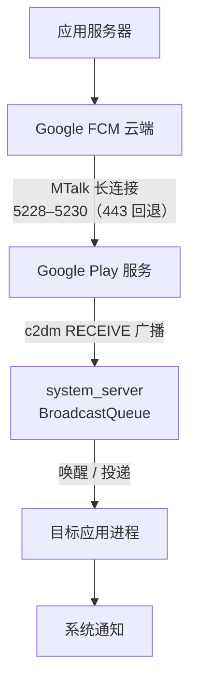
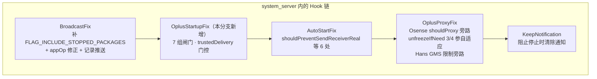
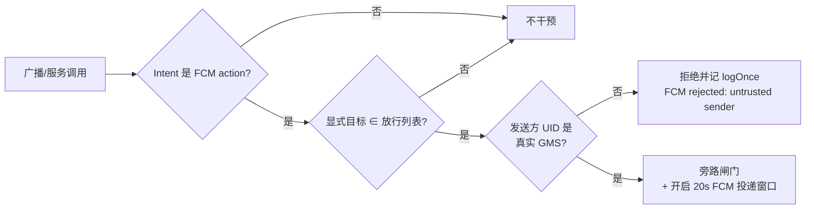
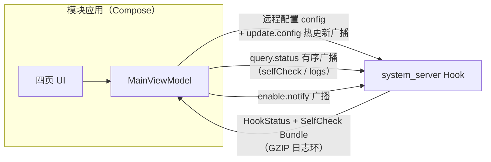

<div align="center">

# fcmfix · OxygenOS 16 增强版

**让 FCM 唤醒已停止的应用 · 穿透 oplus 启动闸门 · Material 3 全新界面**

[](#兼容性)
[](#构建)
[](#界面)
[](app/build.gradle)
[](app/build.gradle)
[](LICENSE)

*基于 [kooritea/fcmfix](https://github.com/kooritea/fcmfix) · 参考 [FCMFix ColorOS](https://github.com/Artifical0/fcmfix-oneplus15-coloros16) · 独立签名维护*

</div>

---

## 目录

- [这是什么](#这是什么)
- [问题背景：FCM 推送为什么断](#问题背景fcm-推送为什么断)
- [工作原理](#工作原理)
- [信任模型](#信任模型)
- [界面](#界面)
- [一键开启通知](#一键开启通知)
- [兼容性与降级设计](#兼容性与降级设计)
- [构建](#构建)
- [安装](#安装)
- [排障](#排障)
- [与上游 / ColorOS 版对比](#与上游--coloros-版对比)
- [参考引用](#参考引用)
- [致谢与许可](#致谢与许可)

---

## 这是什么

这是一个 **[kooritea/fcmfix](https://github.com/kooritea/fcmfix)（v53）** 的增强 fork，在一加 15 / OxygenOS 16（Android 16）上开发验证。相对上游的三组增量：

| 增量 | 内容 |
|---|---|
| **Hook 扩展** | 从 [FCMFix ColorOS](https://github.com/Artifical0/fcmfix-oneplus15-coloros16) 移植 **7 组 oplus 启动闸门旁路**（上游只旁路 1 个点），覆盖 ColorOS/OxygenOS 16 迁移后的全部拦截位置；自动放行的 `FcmPackages` 应用扫描一并移植 |
| **诊断后端** | 移植完整自检栈：FCM 连接 sock_diag 监测、hook 组状态上报、推送/事件时间线、Root 报告导出 |
| **UI 重写** | Jetpack Compose + Material 3 全新界面（状态 / 应用 / 时间线 / 设置四页），动态取色，**自动放行开关**与**一键开启通知** |

上游的推送修复逻辑、配置契约（远程配置键与热更新广播）**保持原样**；本分支使用独立签名（`CN=uuapi fcmfix`），与官方发布版相互区分、无法互相覆盖安装。

> 适用环境：需要 **Root + LSPosed**（libxposed API 100+，构建目标 102）。
> 已在一加 15（PLK110，OxygenOS 16 / Android 16）实测；国行 ColorOS 16/17 的闸门签名来自 [ColorOS 版](https://github.com/Artifical0/fcmfix-oneplus15-coloros16)在 PLK110 国行固件上的核对，国际版类名差异会以 `hook error` 日志显式暴露并保持系统原行为。

---

## 问题背景：FCM 推送为什么断

FCM 的正常链路是一条由 Google 维护的长连接推送管道：



在 OxygenOS 16 上，这条链路有三个已被证实会断掉的环节（本分支开发过程中的实机分析）：

**① stopped 态广播丢弃**（AOSP 层）。
应用被划掉或强停后进入 stopped 状态，GMS 发出的广播不带 `FLAG_INCLUDE_STOPPED_PACKAGES`，AOSP 直接丢弃并打印 `Failed to broadcast to stopped app`。这是上游 fcmfix 的核心修复点［[1］](#参考引用)。

**② oplus 启动闸门拦截**（厂商层）。
ColorOS/OxygenOS 16 把冷启动拦截从旧的 `shouldPreventSendReceiverReal` 迁移到了一整套新闸门：应用分类、GCM bind、startService、冷启动限制表、云控恶意名单、关联启动计数。上游只旁路了旧路径，ColorOS 版的固件核对文档记录了全部新闸门［[2］](#参考引用)——本分支把它们移植到了上游代码里。

**③ 后台冻结与广播跳过**（用户自装模块层）。
以 [NoActive](https://github.com/Xposed-Modules-Repo/cn.myflv.noactive)（`cn.myflv.noactive` Pro v400）为例，反编译确认其机制为 cgroup freezer（v1/v2）+ `freezeBinder`，并在 opl.us 框架上同时 hook `com.android.server.hans.freeze.HansNativeService`；其广播 hook 对已冻结进程返回 `"Skip broadcast to frozen process"` **直接丢弃广播**，仅当其 `receiveFCM` 开启时对 `.android.c2dm.intent.RECEIVE` 给予 15 秒解冻窗口。**GMS 若被冻结，长连接心跳同样停止**。这类冲突无法靠推送模块单方面解决，需要按状态分工（见下表）。

| 应用状态 | 责任归属 |
|---|---|
| stopped（划掉 / 刚重启） | **本模块** `BroadcastFix` 补 flag 唤醒 |
| 冻结（后台被压制） | 压制模块自身的 FCM 救援（如 NoActive `receiveFCM`），或将其加入白名单 |
| GMS 网络不通（DNS 污染 / 5228–5230 封锁） | 网络层解决（如 bindhosts FCM 白名单），本模块不处理 |

---

## 工作原理

全部 hook 运行在 **system_server**（`java_init.list` → `XposedMain.onSystemServerStarting`），按推送链路的干预位置划分：



### Hook 矩阵

| 环节 | 类 | 目标（FQCN#method） | 效果 |
|---|---|---|---|
| stopped 广播 | `BroadcastFix` | `BroadcastController/AMS#broadcastIntentLocked`（API 35+ 新旧路径自适应 + 参数名混淆兜底） | 放行列表内应用的 FCM 广播补 `FLAG_INCLUDE_STOPPED_PACKAGES`，appOp 缺省时补 11 |
| 应用分类闸门 | `OplusStartupFix` | `OplusAppStartupManager$OplusStartupStrategy#isAppClassifyRestricted` | 可信投递 → 返回 false（不限制）；ColorOS 17 的无 Intent 重载被识别并跳过 |
| GCM bind 闸门 | `OplusStartupFix` | `OplusAppStartupManager#isAllowStartFromBindService`（type = `bsgcm` / `system[gcm]`） | 可信投递 → 返回 true |
| startService 闸门 | `OplusStartupFix` | `OplusAppStartupManager#isAllowStartFromStartService` | 同上 |
| 冷启动限制表 | `OplusStartupFix` | `OplusAppStartupManager#validStartProcessFromBroadcast` | 可信投递 → 返回 false |
| 云控恶意名单 | `OplusStartupFix` | `MaliciousRestrictPolicy#shouldPreventBroadcastByMaliciousCheck / …ByService…` | 可信投递 → 返回 false；名单类缺失且固件为“仅 Activity 拦截”变体时标记 `NotApplicable` |
| 关联启动 | `OplusStartupFix` | `OplusLinkStartManager#handleProcessBroadcastStartLocked` | 可信投递 → 返回 false |
| 旧自启动路径 | `AutoStartFix` | `BroadcastQueue(Injector/Impl/ModernStubImpl)#checkApplicationAutoStart` 等 6 处 | 上游原逻辑保留（含 MIUI/HyperOS） |
| 广播代理 | `OplusProxyFix` | `OplusProxyBroadcast#shouldProxy`（8 参） | FCM 广播返回 `NOT_INCLUDE`，不经 Osense 代理 |
| 代理唤醒锁 | `OplusProxyFix` | `OplusProxyWakeLock#unfreezeIfNeed`（3/4 参运行时探测后缓存） | 推送时解冻目标 UID |
| Hans GMS 限制 | `OplusProxyFix` | `OplusBgSceneManager#registerGmsRestrictObserver / updateGmsRestrict`、`OplusStartupStrategy#isGoogleRestricInfoOn` | 置空 / 返回 false |
| 通知保留 | `KeepNotification` | `NotificationManagerService#cancelAllNotificationsInt` | 可选：阻止系统在应用停止时清除已有通知 |

### 信任模型

对闸门的旁路**不是无条件放行**，全部经过与 ColorOS 版一致的 `trustedDelivery` 门控［[2］](#参考引用)：



- **发送方核验**：广播路径读取 `BroadcastRecord.callingUid`；服务路径按 `OplusAttribution` 中经国行固件核对的 **3 张参数位签名表**定位调用方 UID（未知签名 fail-closed 并记 `Unsupported Oplus delivery signature`）——防止恶意应用伪造 GMS 广播为自己解锁启动闸门；
- **动作域限定**：只处理 `FcmTrust` 中的 FCM action 集合（`c2dm.intent.RECEIVE` / `MESSAGING_EVENT` / `INSTANCE_ID_EVENT`）；
- **投递窗口**：可信投递为目标 UID 建立 20 秒窗口（`FcmDeliveryWindow`），供 service 闸门判断“应用自己 bind 自己的 `FirebaseMessagingService`”这类回环场景。

---

## 界面

Jetpack Compose + Material 3 全新实现（参考 ColorOS 版设计语言）：动态取色（Android 12+ 壁纸色板）+ 靛蓝自定义色板（完整暗色）、语义状态色独立于主题、设置风格的分组卡片。底部三 Tab + 全屏设置页 + 应用详情底部弹层。

| 页面 | 内容 |
|---|---|
| **状态** | 顶部结论卡（首项问题或 FCM 连接判定）→ 模块/hook 组状态（生效 / 失配 / 不适用，**失配原因逐条列出**）→ 配置同步 → FCM 连接（sock_diag 实时判定：重传卡死 / 静默超时 / 断线史）→ GMS 联网策略、待机分组、电池优化白名单 → 反馈（复制结果 / Root 导出完整报告） |
| **应用** | 搜索 + 筛选 chips（全部 / 包含 FCM / 已放行 / 需要注意）；**自动放行开关**（放行 + excludeList 排除语义，新装应用自动纳入）；放行开关；每行显示 FCM / 自动放行徽标、待处理问题或最近推送；详情弹层含通知 / 待机分组 / 推送次数 / 进程状态 |
| **时间线** | 亮灭屏、深度 Doze、网络切换、FCM 连接变化、推送事件按天分组（sticky header），按类型筛选着色 |
| **设置** | 阻止停止时清除通知、允许唤醒冰箱冻结应用、放行所有包含 FCM 的应用、关于 |

### 诊断后端

应用与 system_server 之间的全部通信都经过 **发送方身份校验**（`BroadcastOptions.setShareIdentityEnabled` + `getSentFromPackage/Uid` 比对），三条信道：



- **FCM 连接监测**（`FcmConnectionMonitor`）：netlink `sock_diag` 每 60s 采样（uptime Handler，不唤醒设备），识别 5228–5230 直连与 mtalk.google.com 的 443 回退（地址自学习）；无响应判定 = 连续重传 ≥3 次或 30 分钟无数据；连接更换计“重连”、采样窗口内消失计“断线”；
- **Hook 组状态**（`HookStatus`）：每组闸门安装结果（active / failed: 原因 / skipped: 不适用）逐条上报，失配在状态页可见、`hook error` 同步写入 logcat；
- **时间线与推送**：内存环（事件 300 条 / 推送 150 条，重启清空）+ `PushRecords` LRU（256 应用），不落盘；
- **报告导出**：Root 运行打包在 APK 内的 `collect-report.sh`（只读状态与日志），附自查文本与各进程 GZIP 日志环。

---

## 一键开启通知

部分 FCM 应用安装后通知开关默认关闭——模块投递了推送，通知却弹不出来。通知开关的授权在 system_server 手里，因此模块可以代为开启：

- 应用页横幅：**「N 个放行的应用通知已关闭」→ 点击一键全开**；
- 应用详情弹层：通知关闭时出现「开启通知」行；
- 实现路径：应用发送 `enable.notify` 广播（身份校验）→ system_server 调用 `INotificationManager#setNotificationsEnabledForPackage(pkg, uid, true)`（工作线程）。

**边界**：仅对已放行应用生效；只开不关；Android 14+；应用自身静音的**通知类别（channel）**不会被触碰（状态页以 WARN 提示，需在应用内恢复）。

---

## 兼容性与降级设计

- **签名探测全部 fail-loud**：闸门方法按“方法名 + boolean 返回类型 + 参数形状”枚举匹配；类缺失 → `NoClassDefFoundError`、签名不匹配 → `NoSuchMethodError`，统一记 `hook error <组名>` 并**保持系统原行为**——任何单组失配不影响其他组；
- **签名表显式声明**：`OplusAttribution` 只收录国行 PLK110（ColorOS 16/17）核对过的 3 张签名，未知 OTA 直接拒绝旁路而不是猜测参数位；
- **诊断先于失效**：状态页把每组的实际安装结果摆在明面上，国际版与国行的类名差异可直接从失配详情定位。

**实测**：一加 15 PLK110 / OxygenOS 16（Android 16）——推送修复 + 状态/时间线全链路。

---

## 构建

| 依赖 | 版本 |
|---|---|
| JDK | 17+（CI 与本仓库验证使用 21） |
| Android SDK | platform **36**（build-tools 34/35/37 任一） |
| Gradle | 8.13（wrapper 自带） |
| AGP / Kotlin | 8.13.0 / 2.2.21（+ Compose compiler 插件） |
| libxposed | `api` 102.0.0（compileOnly）· `interface`/`service` 101.0.0 |

```bash
./gradlew assembleDebug        # 产物 app/build/outputs/apk/debug/app-debug.apk
./gradlew assembleRelease      # 同签名 release 包
```

**签名**：`keystore.properties`（已 gitignore）指向本地 keystore：

```properties
storeFile=<绝对路径>/fcmfix-uuapi.jks
storePassword=…
keyAlias=fcmfix
keyPassword=…
```

存在时 debug/release 均以 `CN=uuapi fcmfix`（RSA 4096，30 年）签名；不存在（新 clone / CI）时回退默认 debug 签名。CI 出签名包需在仓库 Secrets 配置 `SIGNINGKEYBASE64 / ALIAS / KEYSTOREPASSWORD / KEYPASSWORD`。

---

## 安装

1. LSPosed 中启用模块，作用域勾选 **系统框架**，重启手机；
2. 打开应用，在「应用」页放行需要推送的应用（或设置中「放行所有包含 FCM 的应用」），确认这些应用**通知已开启**（状态页 FAIL 会提示，横幅可一键开启）；
3. 压制后台的模块（如 NoActive）请确保 **GMS 在其白名单**、并开启其自身的 FCM 救援开关——两个 FCMFix 系模块不要同时启用。

> ⚠️ system_server 级 Hook：安装前请保留进入安全模式或禁用模块的恢复手段；OTA 后 Hook 失配时会保持系统原行为并在状态页显示。

---

## 排障

```bash
# Hook 安装与投递日志
adb logcat -d | grep "\[fcmfix\]"

# stopped 广播是否还被丢弃
adb logcat | grep -iE "Failed to broadcast to stopped|Send Forced Start Broadcast"

# 冻结类压制模块是否在丢广播（NoActive 特征）
adb logcat | grep -iE "Skip broadcast to frozen|FCM推送"
```

优先用**状态页**：hook 组失配、FCM 连接判定、待机分组降级、通知关闭都会直接给出结论与建议；有 Root 时「导出完整报告」包含自查文本 + 各进程模块日志环（不受 logcat 缓冲限制）。

---

## 与上游 / ColorOS 版对比

| | [上游 kooritea/fcmfix](https://github.com/kooritea/fcmfix) | [FCMFix ColorOS](https://github.com/Artifical0/fcmfix-oneplus15-coloros16) | **本分支** |
| --- | --- | --- | --- |
| 目标系统 | Android 10–15 通用 | 国行 ColorOS 16/17 | **OxygenOS 16 / ColorOS 16 系**（Android 16 实测） |
| 启动闸门 | 1 处（旧路径） | 7 组 | **7 组（移植）+ 旧路径保留** |
| 诊断 | logcat | 状态/应用/时间线三页 + 报告导出 | **同左**（电池进程行裁剪，国际版无电池作用域） |
| 一键开启通知 | ✗ | ✗ | **✓** |
| 自动放行 | ✗ | ✓ | **✓（完整移植，含 excludeList）** |
| libxposed API | 101 | 100+ | **102**（min 100 保持兼容） |
| 界面 | 旧式列表 | Compose M3 | **Compose M3（同设计语言重实现）** |
| 签名 | 官方发布 | 官方发布 | **独立密钥（CN=uuapi fcmfix）** |

---

## 参考引用

1. **kooritea/fcmfix**（上游，MIT）— `Failed to broadcast to stopped app` 问题的原始分析与修复；本仓库的 hook 框架、BroadcastFix、KeepNotification 均源于此。<https://github.com/kooritea/fcmfix>
2. **Artifical0/fcmfix-oneplus15-coloros16**（FCMFix ColorOS，MIT）— ColorOS 16/17 七组启动闸门的发现、`trustedDelivery` 信任模型、`OplusAttribution` 签名表、sock_diag 连接监测与 Compose UI 设计均来自该项目；本仓库在其 v13.2 基础上裁剪移植。<https://github.com/Artifical0/fcmfix-oneplus15-coloros16> · 固件核对：<https://github.com/Artifical0/fcmfix-oneplus15-coloros16/blob/master/docs/firmware-notes.md> · 模块仓库：<https://github.com/Xposed-Modules-Repo/io.github.artifical0.fcmfix.coloros>
3. **NoActive**（`cn.myflv.noactive`）— 墓碑冻结模块；本仓库在开发中对其 Pro v400 反编译确认了 cgroup freezer + `freezeBinder` 机制与 `"Skip broadcast to frozen process"` 广播丢弃行为，以及 `receiveFCM` 的 15 秒解冻窗口（[问题背景](#问题背景fcm-推送为什么断)）。<https://github.com/Xposed-Modules-Repo/cn.myflv.noactive> · <https://app.myflv.cn>
4. **libxposed 现代 API** — 模块基于 `io.github.libxposed:api`（本分支升至 102）。<https://github.com/libxposed/api> · <https://github.com/libxposed/service>
5. **LSPosed** — 运行容器与远程配置 / 作用域服务。<https://github.com/LSPosed/LSPosed>
6. **AOSP `FLAG_INCLUDE_STOPPED_PACKAGES`** — stopped 包广播语义。<https://developer.android.com/reference/android/content/Intent#FLAG_INCLUDE_STOPPED_PACKAGES>
7. **dontkillmyapp.com** — 厂商后台管控行为汇总（Oplus 部分）。<https://dontkillmyapp.com/oppo>

---

## 致谢与许可

- [kooritea](https://github.com/kooritea) 的上游 fcmfix 与 [ByteJuno（Artifical0）](https://github.com/Artifical0) 的 ColorOS 版是本分支的全部技术来源，深表感谢；
- 本分支遵循上游与 ColorOS 版的 **[MIT License](LICENSE)** 修改与分发；
- 分支维护：[uuapi/fcmfix](https://github.com/uuapi/fcmfix)。推送修复逻辑向上游对齐，闸门与诊断逻辑向 ColorOS 版对齐，差异均以注释标明出处。
